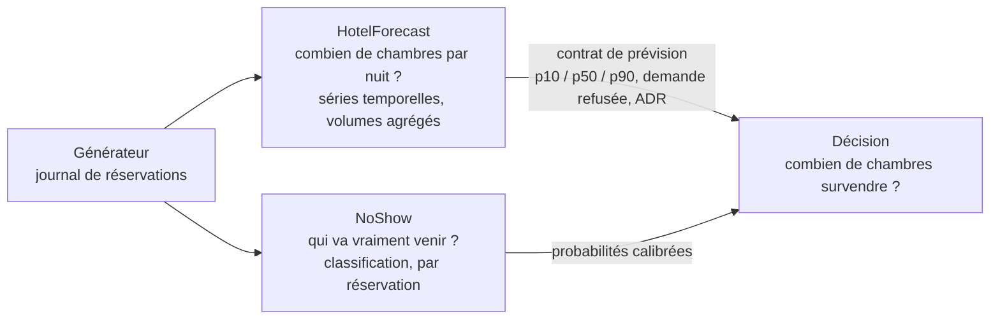
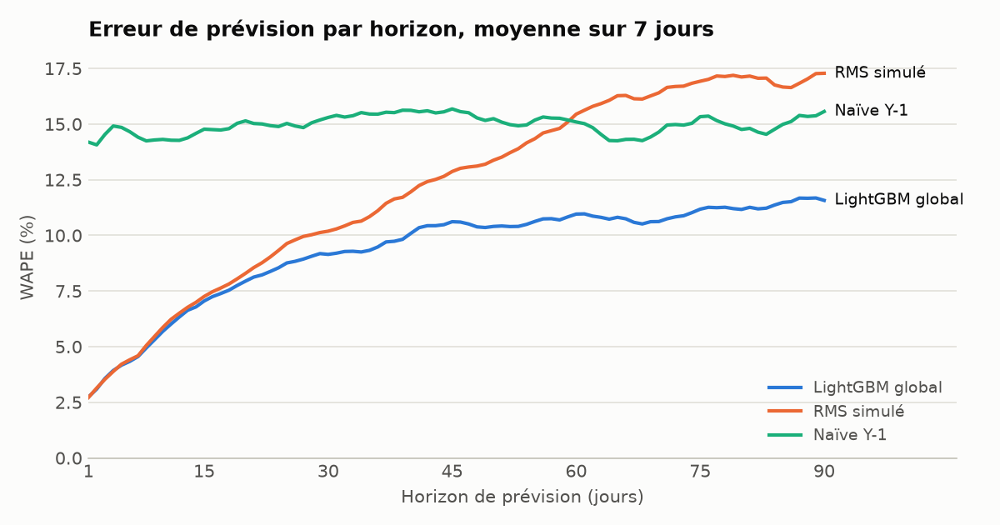
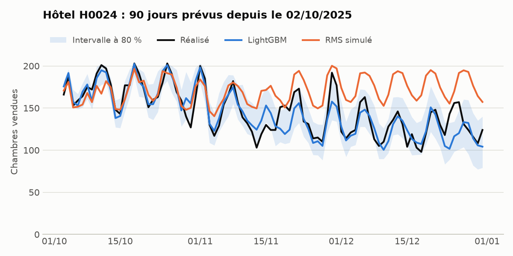
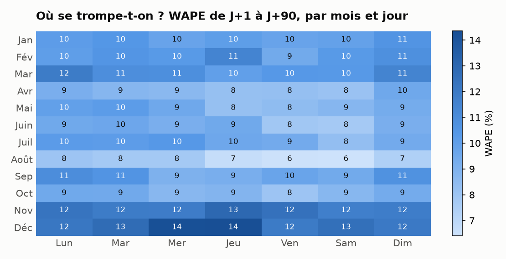
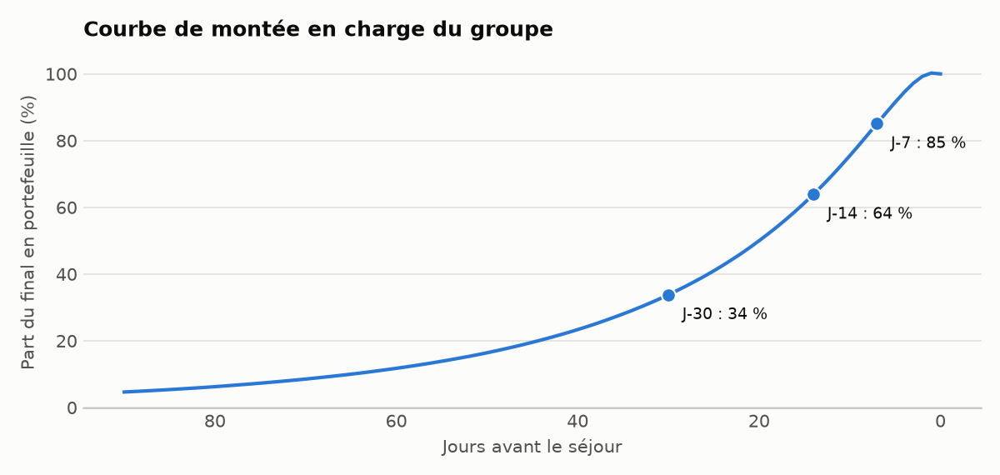

# HotelForecast

**À J+30, 9,1 % d'erreur (WAPE) contre 10,2 % pour le RMS simulé et 15,3 % pour la baseline naïve, mesuré par backtest à origine glissante sur un groupe hôtelier fictif de 60 hôtels.**

Outil de prévision de la demande hôtelière par séries temporelles : chambres vendues, ADR et RevPAR, hôtel par hôtel et nuit par nuit, de J+1 à J+90. Il mesure aussi sa propre précision, celle d'un RMS de référence, et repère les hôtels qui dérivent.


> **Toutes les données sont fictives.** Le groupe, ses hôtels et ses réservations sortent d'un générateur déterministe inclus dans ce dépôt.

## Le duo HotelForecast + NoShow

Ce projet forme une paire avec [NoShow](https://github.com/Aminebousmah/NoShow). Les deux partagent le même groupe fictif et répondent à deux questions différentes :



HotelForecast repère les nuits sous tension, NoShow décide du niveau de surréservation. Sur le test de NoShow, le tiers de nuits que ce projet juge sous tension concentre 82 % du gain de surréservation.

## Résultats

Six origines de prévision, du 26/12/2024 au 02/10/2025, soit 32 400 prévisions hôtel × nuit. Chaque horizon H agrège les jours H-6 à H pour lisser l'effet du jour de semaine.

| WAPE (chambres vendues) | J+7 | J+30 | J+90 |
|---|---:|---:|---:|
| **LightGBM global** | **4,6 %** | **9,1 %** | **11,6 %** |
| RMS simulé | 4,6 % | 10,2 % | 17,2 % |
| Naïve Y-1 alignée | 14,4 % | 15,3 % | 15,5 % |
| Moyenne mobile 28 j | 12,7 % | 14,3 % | 19,0 % |
| AutoETS | 12,2 % | 15,0 % | 19,1 % |
| MSTL | 13,1 % | 14,5 % | 14,5 % |



- **Gain contre le RMS simulé :** 10 % d'erreur en moins à J+30, 33 % à J+90, aucun à J+7, où le portefeuille déjà réservé dit presque tout.
- **Biais :** inférieur à 0,3 % en valeur absolue sur les trois horizons.
- **Intervalle à 80 % :** couverture réelle de 76,4 %, donc un peu trop étroit.
- **ADR et RevPAR :** WAPE de 2,9 % sur l'ADR et de 11,2 % sur le RevPAR, tous horizons confondus.



### Où se trompe-t-on ?

| WAPE à J+30 | Naïve Y-1 | RMS simulé | LightGBM |
|---|---:|---:|---:|
| Économique | 16,5 % | 11,2 % | 10,5 % |
| Milieu de gamme | 14,4 % | 9,6 % | 8,4 % |
| Haut de gamme | 15,1 % | 9,5 % | 8,0 % |



### Montée en charge

Le groupe a 34 % de ses chambres finales en portefeuille à J-30, 64 % à J-14 et 85 % à J-7.



### Hôtels en dérive

Le générateur fait baisser la demande de 4 hôtels sur 60 en fin de période. Classés par évolution contre Y-1 sur 28 jours, ces 4 hôtels sortent aux 4 premières places (`reports/drift_report.csv`). C'est un cas d'école : leur baisse est franche, et une dérive réelle serait plus difficile à isoler.

### La réconciliation hiérarchique n'a pas été retenue

J'ai testé une réconciliation MinT à poids structurels, avec LightGBM au niveau hôtel et AutoETS aux niveaux agrégés. Elle dégrade tous les niveaux :

| WAPE, J+1 à J+90 | Somme des hôtels LightGBM | Réconcilié |
|---|---:|---:|
| Hôtel | 9,6 % | 11,8 % |
| Marque × région | 4,5 % | 8,1 % |
| Marque | 2,4 % | 6,3 % |
| Groupe | 1,6 % | 5,9 % |

Le modèle global voit déjà tous les hôtels, et les prévisions agrégées d'AutoETS, moins précises, le tirent vers le bas. La production additionne donc simplement les hôtels : les agrégats sont cohérents par construction, et l'écart mesuré entre le groupe et la somme des hôtels est nul à la précision machine près.

## Démarrage

```bash
uv sync
uv run hotelforecast simulate --hotels 60 --years 4 --seed 42
uv run hotelforecast backtest --horizons 7,30,90 --folds 6
uv run hotelforecast report
uv run streamlit run app/streamlit_app.py
```

Pour alimenter le modèle en étoile dans ClickHouse :

```bash
docker compose up -d clickhouse
uv run hotelforecast load
cd dbt && uv run dbt build --profiles-dir . && cd ..
```

Pour produire le contrat lu par NoShow :

```bash
uv run hotelforecast forecast --asof 2025-06-01
uv run hotelforecast rolling-contract --start 2025-01-01 --end 2025-12-31 --horizon 7
uv run hotelforecast export-bookings --hotels 12
```

## Comment c'est construit

- **Une seule source de vérité.** Le générateur simule chaque demande de réservation, l'accepte selon le stock disponible, puis l'annule éventuellement. Chambres vendues, portefeuille, ADR et RevPAR en découlent tous.
- **Le monde simulé.** Saisonnalité annuelle et hebdomadaire, jours fériés et vacances scolaires françaises, salons, JO de Paris 2024, rénovations et dérives.
- **Le RMS de référence.** Un pick-up additif classique, aveugle au calendrier des événements, avec un biais propre à chaque hôtel. Il réagit au portefeuille, sans le bruit artificiel qui le rendrait facile à battre.
- **Le modèle.** Un LightGBM quantile global, une ligne par hôtel × origine × horizon : portefeuille, rythme de réservation, pick-up, Y-1 et Y-2 alignés sur le jour de semaine (364 jours), calendrier.
- **Le backtesting.** Origine glissante uniquement. Un test réécrit tout ce qui suit l'origine et vérifie que les features ne bougent pas.
- **Les garde-fous.** Prévisions plafonnées à la capacité et positives, quantiles ordonnés, comparaison systématique à la naïve et au RMS.

```
src/hotelforecast/
  simulate.py     générateur déterministe
  features.py     features à date de prévision
  models/         baseline, stats, lgbm, reconcile
  backtest.py     évaluation à origine glissante
  metrics.py      WAPE, MAPE, sMAPE, biais, couverture
  contract.py     contrat de prévision pour NoShow
  report.py       figures du README
dbt/              staging -> marts (fact_daily_hotel, fact_forecast, fact_accuracy)
app/              dashboard Streamlit
docs/adr/         décisions d'architecture
```

Décisions documentées : [LightGBM global](docs/adr/0001-lightgbm-global.md), [ClickHouse](docs/adr/0002-clickhouse.md), [WAPE](docs/adr/0003-wape.md).

## Limites

- **Données synthétiques.** Ces chiffres mesurent la capacité du modèle à retrouver les structures du générateur. Ils ne disent pas ce qu'il ferait sur de vraies données.
- **RMS simulé.** Le gain contre le RMS dépend de la façon dont je l'ai construit. Ce n'est pas une comparaison avec un produit du marché.
- **Demande censurée.** La cible est plafonnée à la capacité. La demande refusée est connue ici parce que le simulateur l'enregistre, ce qu'un hôtel réel observe mal.
- **Peu d'origines.** Six origines couvrent une seule année : la stabilité des résultats d'une année à l'autre n'est pas testée.
- **Intervalles.** La couverture de 76,4 % reste sous les 80 % visés.

## Licence

MIT
